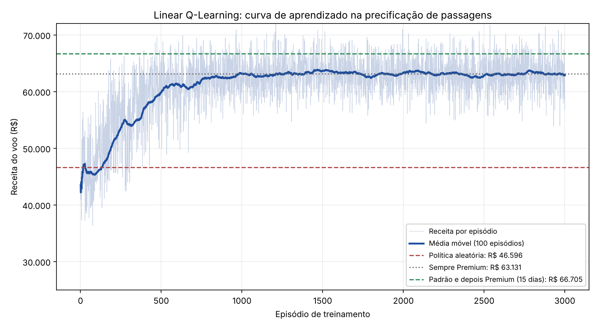

# haskell-linear-qlearning-pricing

<p align="center"></p>

[English](#english) | [Português](#português)

---

## English

Linear Q-Learning in Haskell: an agent that learns dynamic ticket pricing for an airline (revenue management).

Final project for **Paradigms and Emerging Technologies in Data Science** (topic 2.1, Linear Q-Learning), Data Science program at Fatec Baixada Santista.

- **Professor:** Felipe Cannarozzo
- **Team:** Adam Stader, Guilherme Franco, Lucas Laus and Victor Leme

### Scenario

An airline has 100 seats to sell over 30 days before takeoff. Seats left empty at takeoff are worth nothing. Every day the agent chooses a price, passengers buy according to demand and price elasticity, and the reward is the revenue of that day.

- **State (s):** share of seats still available, share of time left until the flight and a recent demand index. All continuous, so a table with one row per state is not feasible.
- **Actions (a):** three prices, promotional (R$ 300), standard (R$ 550) and premium (R$ 900).
- **Reward (r):** daily revenue, price times seats sold.

### Idea

Instead of a Q-table with one entry per state and action, Q(s, a) is approximated linearly:

```
Q(s, a) = w . phi(s, a)
```

where `phi(s, a)` is a feature vector (here, 5 features per action, 15 in total) and `w` is a weight vector updated at each step with the semi-gradient rule:

```
delta = r + gamma * max_a' Q(s', a') - Q(s, a)
w     = w + alpha * delta * phi(s, a)
```

`alpha` is the learning rate and `gamma` is the discount factor. Actions are chosen with an epsilon-greedy policy.

### Structure

```
app/
  Main.hs           Training loop, evaluation and report
src/
  Types.hs          Actions, state and hyperparameters
  Environment.hs    Stochastic flight simulator (demand and price elasticity)
  Features.hs       Feature vector phi(s, a) and vector operations
  Agent.hs          Q prediction, epsilon-greedy policy and weight update
  Metrics.hs        Averages, block summaries, CSV export and weights report
data/               Reserved for input files (the demo simulates its own data)
docs/               Slides (PPTX and PDF), logo and learning curve chart
```

### Running

Requires GHC and Cabal (tested with GHC 9.10.3 and cabal-install 3.16.1.0, on Windows). The first run downloads the `random` package, so it needs an internet connection.

```
cabal build
cabal run linear-q-pricing
```

The run is reproducible: the random seed is fixed. Small differences in the decimals may appear with other versions of `random`. At the end, the program writes `curva_aprendizado.csv` (one row per training episode) in the current folder.

### Results

3000 training episodes, then 500 out-of-sample test flights (alpha = 0.005, gamma = 0.99).

| Policy | Mean revenue (R$) | Occupancy |
|---|---|---|
| Random (baseline) | 46,596 | 100.0% |
| Always promotional (R$ 300) | 30,000 | 100.0% |
| Always standard (R$ 550) | 55,000 | 100.0% |
| Always premium (R$ 900) | 63,131 | 70.1% |
| **Linear Q-Learning** | **63,702** | 73.7% |
| Standard until 15 days left, then premium | 66,705 | 92.1% |

The learned policy earns **+36.71%** over the random baseline and beats the single-price rules. It stays about 4.5% below the hand-written rule that switches price 15 days before takeoff. A linear model with 5 features per action approximates a step change in time poorly, which points to richer features as future work.



### Slides

Presentation slides: [PDF](docs/linear-q-learning-haskell-slides.pdf) | [PPTX](docs/linear-q-learning-haskell-slides.pptx).

### Status

Complete. All modules are implemented and the demo runs end to end, printing the training summary, the benchmark and the learned weights, and exporting the learning curve.

---

## Português

Linear Q-Learning em Haskell: um agente que aprende a precificação dinâmica de passagens aéreas (revenue management).

Projeto final da disciplina **Paradigmas e Tecnologias Emergentes em Ciência de Dados** (tema 2.1, Linear Q-Learning), curso de Ciência de Dados da Fatec Baixada Santista.

- **Professor:** Felipe Cannarozzo
- **Equipe:** Adam Stader, Guilherme Franco, Lucas Laus e Victor Leme

### Cenário

Uma companhia aérea tem 100 assentos para vender em 30 dias antes da decolagem. Assento vazio na decolagem não vale nada. A cada dia o agente escolhe um preço, os passageiros compram conforme a demanda e a elasticidade ao preço, e a recompensa é a receita daquele dia.

- **Estado (s):** percentual de assentos ainda disponíveis, fração do tempo restante até o voo e um índice de demanda recente. Todos contínuos, então uma tabela com uma linha por estado é inviável.
- **Ações (a):** três preços, promocional (R$ 300), padrão (R$ 550) e premium (R$ 900).
- **Recompensa (r):** receita diária, preço vezes assentos vendidos.

### Ideia

Em vez de uma tabela Q com uma entrada por estado e ação, Q(s, a) é aproximada de forma linear:

```
Q(s, a) = w . phi(s, a)
```

em que `phi(s, a)` é um vetor de características (aqui, 5 por ação, 15 no total) e `w` é um vetor de pesos atualizado a cada passo com a regra semi-gradiente:

```
delta = r + gamma * max_a' Q(s', a') - Q(s, a)
w     = w + alpha * delta * phi(s, a)
```

`alpha` é a taxa de aprendizado e `gamma` é o fator de desconto. As ações são escolhidas com uma política epsilon-greedy.

### Estrutura

```
app/
  Main.hs           Laço de treinamento, avaliação e relatório
src/
  Types.hs          Ações, estado e hiperparâmetros
  Environment.hs    Simulador estocástico do voo (demanda e elasticidade ao preço)
  Features.hs       Vetor de características phi(s, a) e operações vetoriais
  Agent.hs          Predição de Q, política epsilon-greedy e atualização dos pesos
  Metrics.hs        Médias, resumo por blocos, exportação de CSV e relatório dos pesos
data/               Reservada para arquivos de entrada (a demonstração simula os próprios dados)
docs/               Slides (PPTX e PDF), logo e gráfico da curva de aprendizado
```

### Execução

Requer GHC e Cabal (testado com GHC 9.10.3 e cabal-install 3.16.1.0, no Windows). A primeira execução baixa o pacote `random`, então precisa de internet.

```
cabal build
cabal run linear-q-pricing
```

A execução é reproduzível: a semente aleatória é fixa. Pode haver pequenas diferenças nos decimais com outras versões do `random`. No final, o programa grava o `curva_aprendizado.csv` (uma linha por episódio de treinamento) na pasta atual.

### Resultados

3000 episódios de treinamento e depois 500 voos de teste fora da amostra (alpha = 0,005, gamma = 0,99).

| Política | Receita média (R$) | Ocupação |
|---|---|---|
| Aleatória (baseline) | 46.596 | 100,0% |
| Sempre promocional (R$ 300) | 30.000 | 100,0% |
| Sempre padrão (R$ 550) | 55.000 | 100,0% |
| Sempre premium (R$ 900) | 63.131 | 70,1% |
| **Linear Q-Learning** | **63.702** | 73,7% |
| Padrão até faltarem 15 dias, depois premium | 66.705 | 92,1% |

A política aprendida rende **+36,71%** sobre a aleatória e supera as regras de preço único. Fica cerca de 4,5% abaixo da regra manual que troca o preço 15 dias antes da decolagem. Um modelo linear com 5 características por ação aproxima mal uma troca em degrau no tempo, o que aponta características mais ricas como trabalho futuro.


### Slides

Slides da apresentação: [PDF](docs/linear-q-learning-haskell-slides.pdf) | [PPTX](docs/linear-q-learning-haskell-slides.pptx).

### Status

Concluído. Todos os módulos estão implementados e a demonstração roda de ponta a ponta, imprimindo o resumo do treino, o benchmark e os pesos aprendidos, e exportando a curva de aprendizado.
